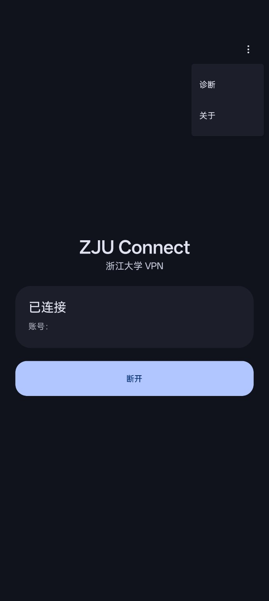
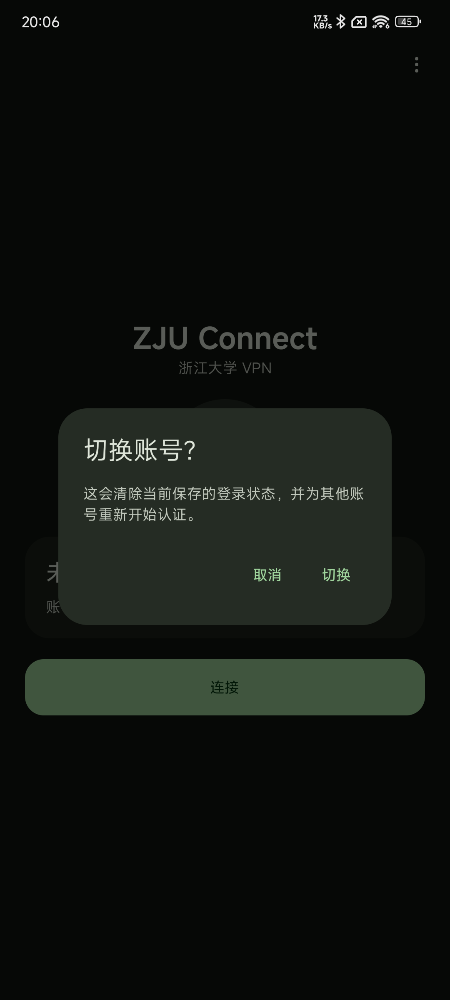
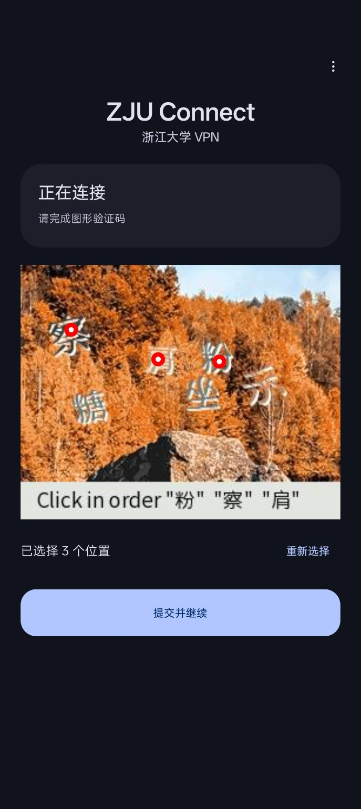

# zju-connect-android

浙江大学 aTrust / RVPN 的开源 Android 客户端，基于 [zju-connect](https://github.com/Mythologyli/zju-connect)，通过系统 VPN 访问校内资源。

**Android 10+ · arm64-v8a · [下载 APK](https://github.com/Cedar17/zju-connect-android/releases)**

## 界面预览

  
  
  

## 安装与使用

1. 在 [Releases](https://github.com/Cedar17/zju-connect-android/releases) 下载 `zju-connect-v*-arm64-v8a.apk` 并安装。首次安装可能需要允许当前浏览器或文件管理器安装应用。
2. 打开 **ZJU Connect**，点击连接，允许 Android 创建 VPN。
3. 按页面提示登录；短信、动态口令和图形验证码等认证步骤由服务端决定。
4. 显示“已连接”后，即可访问 CC98 等校内资源。

普通断开会保留认证状态，下次连接优先复用。应用进程重启后，会尝试从加密保存的 session 恢复；会话过期时，继续完成页面提示的认证。

APK 由 GitHub Actions 构建、测试并签名。已在 Xiaomi K40 / Android 13 和 OnePlus Ace 3V / Android 15 上进行实机测试。

## 功能

- aTrust 登录、VPN 连接与断开；
- 密码、短信、动态口令和图形验证码认证；
- 加密保存 session，按用户选择记住密码；
- Wi-Fi、蜂窝和以太网切换后的连接恢复；
- Android 快捷设置磁贴和 Always-on VPN；
- 应用内诊断报告，方便反馈问题。

### 快捷设置磁贴

在 Android 快捷设置的编辑页面添加 **ZJU Connect**。已有有效认证时，点按磁贴即可连接或断开；需要登录或 VPN 授权时，会打开应用继续处理。

### Always-on VPN

在 Android 系统 VPN 设置中为 ZJU Connect 开启 Always-on，系统会在开机或服务进程重启时启动连接。后台恢复使用已保存的 session，需要重新认证时会提示你打开应用。

### 网络切换

底层网络变化后，应用会重建隧道；没有可用网络时等待网络恢复。切换过程中会短暂中断。后台运行也受设备的电池管理和系统清理策略影响。

## 问题反馈

在应用菜单中打开 **Diagnostics**，复制报告并附到 [GitHub Issue](https://github.com/Cedar17/zju-connect-android/issues)，再补充网络环境和复现步骤。

报告包含版本、设备、状态、错误码和数据面计数，不含账号、认证凭据或网络端点。请留意额外附上的截图和日志中的个人信息。

## 开发

Android 侧使用 Kotlin、Jetpack Compose 和 Material 3，负责界面、VPN 生命周期及加密存储；Go 核心直接依赖官方 zju-connect，负责 aTrust 协议、认证和数据转发。Go、gomobile、NDK 和核心版本均已固定。

- [架构](docs/architecture.md)：模块职责、连接状态和网络恢复；
- [认证恢复](docs/authentication-recovery.md)：session、保存密码与认证失效的处理；
- [gomobile bridge](docs/gomobile-bridge.md)：Kotlin–Go 接口、构建和发布。

本地 session 与保存密码使用 Android Keystore 加密。TLS 沿用固定上游版本的实现，目前跳过标准证书链和主机名校验；具体边界见架构文档。

## 上游与参考

- [Mythologyli/zju-connect](https://github.com/Mythologyli/zju-connect)：aTrust 协议与网络核心；
- [Mythologyli/ZJU-Connect-for-Windows](https://github.com/Mythologyli/ZJU-Connect-for-Windows)：桌面客户端；
- [Mythologyli/ZJUConnectForAndroid](https://github.com/Mythologyli/ZJUConnectForAndroid)：早期 Android 实现。

## 许可证

[GNU Affero General Public License v3.0](LICENSE)（AGPL-3.0）。本项目是个人维护的非官方客户端，使用时请遵守学校网络和电子资源的相关规定。
