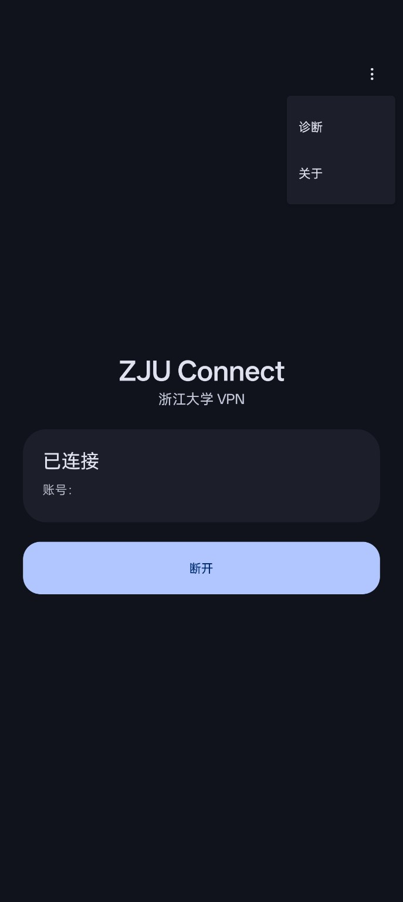
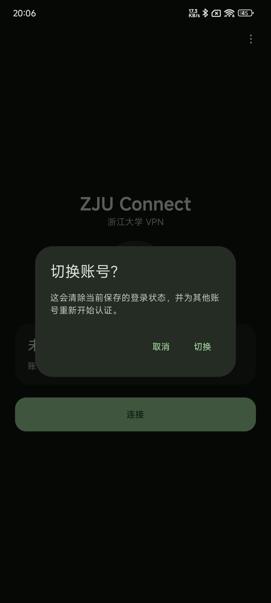
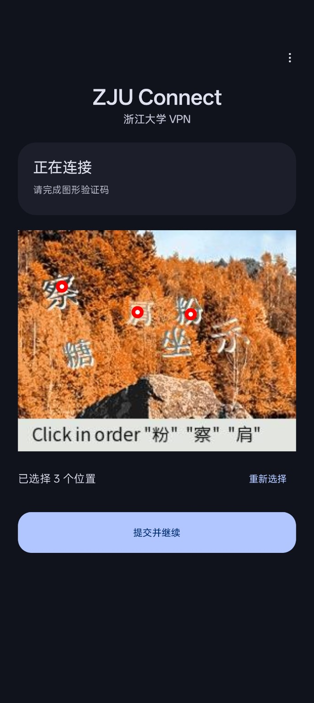

  

# zju-connect-android

  

浙江大学 aTrust / RVPN 的第三方 Android 客户端，基于 [zju-connect](https://github.com/Mythologyli/zju-connect) 开源核心，采用 Material 3 设计，通过系统 VPN 访问校内资源。

**[下载 APK](https://github.com/Cedar17/zju-connect-android/releases)**

## 界面预览

  
  
  

从左到右：连接状态、账号切换与图形验证码登录。

## 功能

- 支持密码、短信、动态口令和图形验证码登录；
- 加密保存登录状态和账号密码，方便再次连接；
- 支持 Wi-Fi、蜂窝和以太网之间的网络切换恢复；
- 支持 Android 快捷设置磁贴和“始终开启 VPN”；
- 支持简体中文和英文，跟随系统语言。

## 安装与使用

1. 在 [Releases](https://github.com/Cedar17/zju-connect-android/releases) 下载 `zju-connect-v*-arm64-v8a.apk` 并安装。首次安装可能需要允许当前浏览器或文件管理器安装应用。
2. 打开 **ZJU Connect**，点击 **连接**，允许 Android 创建 VPN。
3. 按页面提示登录；短信、动态口令和图形验证码等验证步骤由服务端决定。
4. 显示“已连接”后，即可访问 CC98 等校内资源。

密码登录成功后，应用会自动在本机加密保存账号密码。普通断开会保留登录状态，再次连接时优先复用；需要重新登录时，会尝试使用已保存的账号密码，后续验证仍需按提示完成。

切换账号时，先断开连接，再从右上角 **⋮ → 切换账号** 操作。切换会清除当前账号保存的登录状态和密码。

## 使用说明

### 快捷设置磁贴

在 Android 快捷设置的编辑页面添加 **ZJU Connect**。已有有效登录状态时，点按磁贴即可连接或断开；需要登录或 VPN 授权时，会打开应用继续处理。

### 始终开启 VPN

在 Android 系统 VPN 设置中为 ZJU Connect 开启“始终开启 VPN”（Always-on VPN），系统会在开机或服务进程重启时启动连接。需要重新登录时，会提示你打开应用。启用期间如需断开，请先在系统设置中关闭此选项。

### 后台与网络切换

网络变化后，应用会尝试恢复连接；没有可用网络时等待网络恢复。切换过程中可能短暂中断，后台运行也受设备的电池管理和系统清理策略影响。

### 界面语言

应用默认跟随系统语言。Android 13 及以上可在系统的应用语言设置中单独选择简体中文或英文。本文使用中文界面名称。

### 高级设置（实验性）

普通用户无需使用本节功能，默认也不显示入口。

如需连接到自建或镜像部署的 aTrust 服务器：在 **关于** 页面**长按版本号**解锁高级设置，随后右上角 **⋮ → 高级设置** 中会出现「启用自定义服务器（实验性）」开关；再次长按版本号可重新隐藏。开启后可填写自定义服务器地址和端口，连接、保存的登录状态和数据面均使用该服务器；不同服务器的登录状态相互独立，切换服务器后需重新登录。配置无效时连接会明确报错，不会回落到默认服务器。

如需与其他 VPN 应用同时使用校园网：在同一高级设置页开启「仅代理模式（实验性）」并设置本地 SOCKS5/HTTP 端口（默认 127.0.0.1:11080 / 11081）。此模式不创建系统 VPN，而是把校园网流量提供给本地代理，需在其他应用中手动配置代理地址；系统 VPN 槽位不会被占用，可与另一个 VPN 应用共存。代理模式与系统 VPN 模式互斥，且不支持快捷设置磁贴与“始终开启 VPN”。

## 问题反馈

遇到问题欢迎提交 [GitHub Issue](https://github.com/Cedar17/zju-connect-android/issues)，说明网络环境和复现步骤，并附上右上角 **⋮ → 诊断 → 复制报告** 获取的诊断报告。英文界面对应 **Diagnostics → Copy report**。

报告包含版本、设备、状态、错误码和数据面计数，不含账号、认证凭据或网络端点。请留意额外附上的截图和日志中的个人信息。

## 开发

Android 侧使用 Kotlin、Jetpack Compose 和 Material 3，负责界面、VPN 生命周期及加密存储；Go 核心直接依赖官方 zju-connect，负责 aTrust 协议、认证和数据转发。发布的 APK 由 GitHub Actions 构建并签名。

- [架构](docs/architecture.md)：模块职责、连接状态和网络恢复；
- [认证恢复](docs/authentication-recovery.md)：登录状态、保存密码与认证失效的处理；
- [gomobile bridge](docs/gomobile-bridge.md)：Kotlin–Go 接口、构建和发布。

## 上游与参考

- [Mythologyli/zju-connect](https://github.com/Mythologyli/zju-connect)：aTrust 协议与网络核心；
- [Mythologyli/ZJU-Connect-for-Windows](https://github.com/Mythologyli/ZJU-Connect-for-Windows)：桌面客户端；
- [Mythologyli/ZJUConnectForAndroid](https://github.com/Mythologyli/ZJUConnectForAndroid)：面向旧 EasyConnect 协议的早期 Android 实现。

## 许可证

[GNU Affero General Public License v3.0](LICENSE)（AGPL-3.0）。本项目是个人维护的非官方客户端，使用时请遵守学校网络和电子资源的相关规定。
