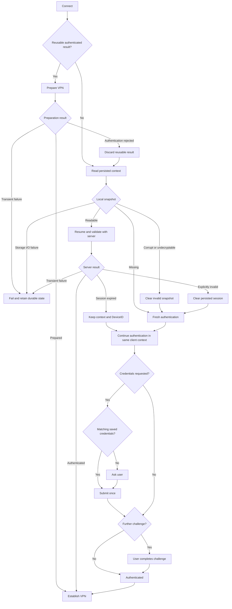

# Authentication recovery semantics

This guide owns authentication state, persistence, reuse and invalidation.
[Architecture](architecture.md) owns Android lifecycle/network recovery;
[gomobile bridge](gomobile-bridge.md) owns the callable API and build boundary.

## Authentication state

| State | Lifetime and role |
| --- | --- |
| Reusable authenticated result | Process-local Go client/resource result; first choice for foreground preparation |
| Persisted context | Encrypted session snapshot, validated with the server after process death or reboot |
| Saved credentials | Separate encrypted username/password, used once per foreground recovery attempt when requested |
| Remembered account | Last server-confirmed username, privately stored for display and prefill |
| Interactive challenge | Current flow's phone selection, SMS, token or CAPTCHA input; not persisted |

Ordinary disconnect, cancellation and Activity/ViewModel recreation preserve
existing authentication assets. The reusable result disappears on process death;
the encrypted stores survive. Account switch clears all four account-specific
assets above before starting another account. Partial clearing stops the switch.

### Snapshot, storage and identity

The exported snapshot contains only `schemaVersion`, `deviceId` and the complete
fixed-endpoint cookie set, including SID. Password, username, resources,
connection ID, sign key, verification input, creation time and server identity
are excluded. `ServerVersionInfo` is not persisted; upstream VPN setup fetches
its manifest again. A core upgrade does not expand this app-owned snapshot.

`AuthSessionStore` and `SavedCredentialStore` use separate Android Keystore
non-exportable AES-GCM keys, fixed authenticated data and atomic encrypted files
in `noBackupFilesDir`. The bridge snapshot is opaque to Kotlin. Plaintext snapshot
buffers are zeroed after bridge use. Remembered username metadata is separate
from both encrypted stores.

Android derives a stable 32-character aTrust DeviceID from its app-scoped
`ANDROID_ID`. The current identity is supplied for fresh authentication and
resume; a legacy snapshot cannot replace it. Session expiry and account switch
preserve this device identity. Identity unavailability is an error, not a reason
to generate an unrelated temporary ID.

Successful authentication refreshes the reusable result and attempts to save the
recovery snapshot and confirmed username. Successful foreground password login
also automatically attempts to save the accepted credentials. There is currently
no remember-password toggle. Saved credentials match the remembered username
(or an empty remembered account) before automatic submission.

## Foreground recovery

App startup itself does not validate a snapshot. A foreground Connect reuses the
strongest available state through one attempt:

The default supported login method is `auth/psw` with the `Radius` domain when
advertised. Otherwise the bridge selects a method only when exactly one
advertised method is supported. SMS, CAPTCHA, TOTP/token and phone selection
remain steps of the current authentication flow.

### Expired, invalid and rejected states

`sessionExpired != invalidSession`: expiry keeps the persisted client context
and DeviceID and continues foreground authentication. A matching saved password
may be submitted once; further challenges require the user.

`sessionInvalid` or `invalidSession` definitively invalidates the persisted
context and triggers fresh authentication. Saved credentials remain available.
During reusable-result preparation, `vpnSessionInvalid` or an authentication /
server-rejection cause clears only that reusable result before trying persisted
recovery. `credentialsRejected` deletes the saved credential and asks for new
input without discarding the persisted context.

Network, DNS, TLS, timeout and storage I/O failures are operational failures.
They retain durable state for retry. Proven malformed/undecryptable local state
is cleared separately from a temporarily unavailable store.

## Invalidation matrix

| Event | Reusable result | Persisted context | Saved credentials | Remembered account |
| --- | --- | --- | --- | --- |
| Ordinary disconnect | retain | retain | retain | retain |
| Activity / ViewModel recreation | retain if process survives | retain | retain | retain |
| Process death or reboot | lost | retain | retain | retain |
| `sessionExpired` | not relied on | retain | foreground may use | retain |
| `sessionInvalid` / `invalidSession` | discard if unusable | clear | retain | retain |
| Reusable result rejected by authentication/server | clear | retain and retry | retain | retain |
| `credentialsRejected` | no result created | retain | clear | retain |
| Network / DNS / TLS / timeout / storage I/O failure | retain | retain | retain | retain |
| User cancellation | retain existing result | retain | retain | retain |
| Corrupt / undecryptable session snapshot | unaffected | clear corrupt snapshot | retain | retain |
| Corrupt saved credential | unaffected | retain | clear corrupt credential | retain |
| Account switch | clear | clear | clear | clear |

The stable DeviceID survives these events unless the app-scoped identity itself
is unavailable. Each failure invalidates only state proven unusable at that layer.

## Foreground and background

Foreground Connect can use the full recovery flow. Quick Settings first reuses
an in-process authenticated result; otherwise Quick Settings and Always-on can
validate the encrypted snapshot through the Service-owned restorer.

Background recovery does not read or submit saved passwords. An expired session,
credential request, phone selection, SMS, token or CAPTCHA stops background
authentication and enters a waiting-for-user state. Opening the Activity hands
authentication to the foreground attempt. A transient failure retains the
snapshot; definitive session invalidation clears it. Retry scheduling and
foreground-service behavior belong to [architecture.md](architecture.md#underlay-recovery).

## Observable recovery paths

The stable labels are defined in
[`AuthenticationRecovery.kt`](../app/src/main/kotlin/io/github/cedar17/zjuconnect/AuthenticationRecovery.kt).
They describe structured recovery events, separate from localized UI text and
from bridge protocol events:

| Field | Allowed recovery values |
| --- | --- |
| Source | `reusable_result`, `persisted_session`, `persisted_session_authenticated`, `persisted_session_stale`, `saved_credentials`, `server_challenge` |
| Outcome | `selected`, `reauthenticating`, `submitted`, `authenticated`, `waitingForUser`, `invalidated`, `rejected`, `unavailable`, `failed` |
| Invalidation cause | `accountSwitch`, `invalidStoredSession`, `reusableResultRejected`, `credentialsRejected` |

For example, stale-session recovery may record `persisted_session / selected`,
`persisted_session_stale / reauthenticating`, then `saved_credentials / submitted`
and `saved_credentials / authenticated`, while the UI presents one connection
attempt. The reusable-result `authenticated` marker follows successful foreground
VPN preparation; it must not be read as a separate fresh password login.

Only these labels and bounded durations reach recovery diagnostics. Sensitive
state follows the [diagnostic and transport boundary](architecture.md#diagnostics-and-transport-security)
and [callback contract](gomobile-bridge.md#kotlin-go-contract).

## Validation contract

The recovery flow and invalidation matrix define policy/unit-test expectations.
Integration acceptance additionally covers:

- Process death/reboot with a valid persisted session, stale-session continuation,
  saved-password reuse and server-required human challenges.
- Foreground cancellation and old callbacks arriving after another attempt.
- Account-switch completion and failure to clear any one account store.
- Quick Settings and Always-on restoration without Activity or saved-password
  access; foreground handoff when participation is required.
- Transient failures retaining state, explicit invalidation clearing only its
  layer, and corrupted local data following the defined cleanup path.

Record concrete device/build results in the PR. Device behavior exercises Android
integration; it does not redefine these recovery semantics.
